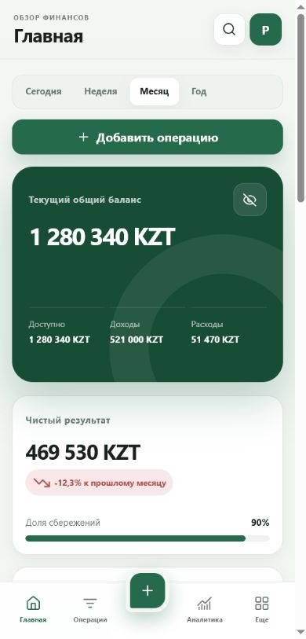
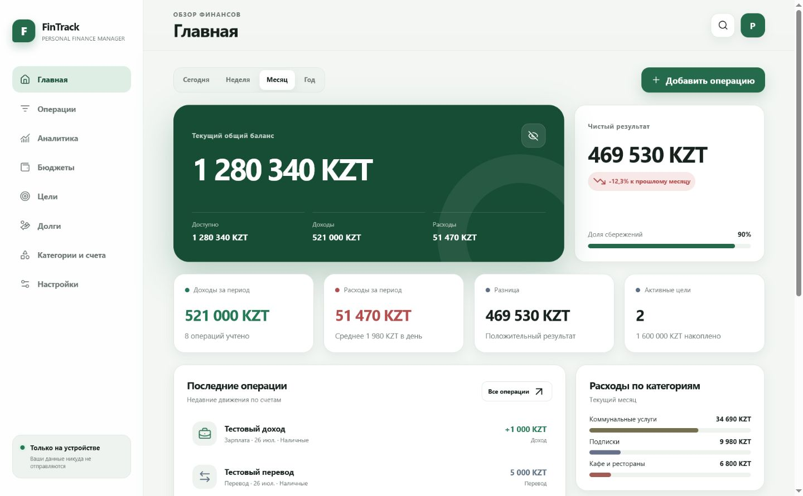

# FinTrack


FinTrack is a mobile-first personal finance manager for recording income and expenses, organizing accounts and categories, creating budgets, tracking financial goals and debts, and understanding spending through responsive analytics.

It is an offline-first Progressive Web App written with semantic HTML, modern CSS, and Vanilla JavaScript ES Modules. The Sites deployment adds an authenticated Cloudflare Worker API and D1-backed cloud synchronization while keeping local data available without a connection.

## Screenshots

| Mobile | Desktop |
| --- | --- |
|  |  |

## Live Demo

Add your GitHub Pages URL here

## Features

- Dashboard with current balance, period income and expenses, net result, comparison with the previous month, recent transactions, category spending, budget progress, and active goals.
- Income, expense, and account-transfer transactions with full and quick mobile-friendly entry.
- Search, filters, date grouping, sorting, editing, duplication, deletion, and undo.
- Multiple accounts with initial and calculated balances, archiving, history, and optional exclusion from the total balance.
- Custom income and expense categories with icon, color, personal limit, visibility, and safe migration of used categories.
- Monthly overall and category budgets with spending, remaining amount, forecast, days left, and 50/80/100% in-app warnings.
- Financial goals with contributions, withdrawals, optional account write-off, target progress, and recommended monthly contribution.
- Debts owed to the user or by the user, partial and full repayment, payment history, overdue state, and archive.
- Recurring operations checked locally on every launch with duplicate protection.
- Six responsive Chart.js visualizations, summary metrics, and a financial calendar.
- Global search across transactions, categories, accounts, debts, goals, notes, and tags.
- Light, dark, and system themes; three restrained accent palettes; persistent privacy controls.
- JSON backup and restore, automatic pre-import local backup, and Excel-compatible UTF-8 CSV export.
- Email/password registration, email confirmation, password recovery, and per-user cloud synchronization.
- Automatic migration of existing local data to the cloud after the first authenticated launch.
- Installable PWA with offline app shell and iPhone safe-area support.

## Mobile-first design

FinTrack was designed for one-handed portrait use. Interactive targets are approximately 44×44 pixels or larger, inputs use at least 16px text to avoid Safari zoom, sheets stay scrollable with the keyboard open, and the bottom navigation accounts for the iPhone Home Indicator through CSS safe-area variables.

The layout scales from iPhone SE through large iPhone models and expands to a sidebar-based desktop workspace without horizontal scrolling.

## PWA and offline support

The Web App Manifest defines standalone display, portrait orientation, app icons, maskable icons, shortcuts, and mobile/desktop screenshots. The Service Worker caches the app shell, removes old cache versions, stores fetched Chart.js and Lucide resources after the first load, and falls back to the cached application or `offline.html`.

Financial data remains usable offline after the first successful online load. Changes are queued locally and synchronized when the connection returns. API responses are never cached by the Service Worker.

## Technologies

- HTML5
- CSS3 with custom properties, safe-area insets, `100dvh`/`100svh`, and reduced-motion support
- Vanilla JavaScript and ES Modules
- LocalStorage behind a dedicated storage layer
- Cloudflare Worker-compatible backend API
- Cloudflare D1 for durable per-user snapshots
- Supabase Auth for email identity and access-token validation
- Drizzle schema and versioned SQL migrations
- Chart.js
- Lucide Icons
- Web App Manifest and Service Worker

## Project structure

```text
fintrack/
├── index.html
├── manifest.json
├── service-worker.js
├── offline.html
├── css/
│   ├── variables.css
│   ├── style.css
│   ├── components.css
│   ├── mobile.css
│   └── animations.css
├── js/
│   ├── app.js
│   ├── router.js
│   ├── storage.js
│   ├── transactions.js
│   ├── categories.js
│   ├── budgets.js
│   ├── goals.js
│   ├── debts.js
│   ├── analytics.js
│   ├── settings.js
│   ├── sync.js
│   ├── backup.js
│   ├── notifications.js
│   └── utils.js
├── assets/
│   ├── icons/
│   └── screenshots/
├── server/
│   └── api.js
├── db/
│   └── schema.ts
├── drizzle/
├── scripts/
│   └── build.mjs
├── tests/
├── package.json
├── README.md
├── LICENSE
└── .gitignore
```

## Installation

Clone the repository and install the development dependencies:

```bash
pnpm install
```

The static application can still be served directly over HTTP. The production build packages the static assets and backend into a Cloudflare Worker-compatible entry point:

```bash
pnpm build
```

## Run locally

Use the Live Server extension in VS Code and open `index.html`, or start any static HTTP server in the project folder. For example:

```bash
python -m http.server 8080
```

Then open `http://localhost:8080`.

## Publish to GitHub Pages

1. Create an empty GitHub repository.
2. Push the project:

```bash
git init
git add .
git commit -m "Initial release of FinTrack personal finance manager"
git branch -M main
git remote add origin YOUR_REPOSITORY_URL
git push -u origin main
```

3. Open the repository **Settings → Pages**.
4. Select **Deploy from a branch**, choose `main` and `/ (root)`, then save.
5. Replace the Live Demo placeholder above with the generated Pages URL.

All runtime paths are relative, so the PWA works from a GitHub Pages repository subdirectory.

## How to install on iPhone

1. Open the deployed FinTrack website in Safari.
2. Tap the Share button.
3. Select “Add to Home Screen”.
4. Tap “Add”.
5. Launch FinTrack from the Home Screen.

iOS does not expose a web API that can open the Add to Home Screen dialog, so FinTrack provides instructions instead of a non-functional install button.

## Usage

Complete or skip onboarding, choose a currency and initial balance, and optionally load demonstration data. Use the highlighted center button to add a transaction. The **More** area opens budgets, goals, debts, categories, accounts, backups, settings, recurring operations, and installation guidance.

## Local data storage

FinTrack stores all information on the current browser profile with these keys:

- `fintrack_settings`
- `fintrack_accounts`
- `fintrack_transactions`
- `fintrack_categories`
- `fintrack_budgets`
- `fintrack_goals`
- `fintrack_debts`
- `fintrack_recurring`
- `fintrack_backups`
- `fintrack_app_state`

The storage module provides `getAll`, `getById`, `create`, `update`, `remove`, `clear`, `exportAll`, `importAll`, `initializeDemoData`, `generateId`, and `validateData` capabilities through focused modules.

## Backend and synchronization

The production backend exposes same-origin endpoints:

- `GET /api/auth/config` — returns the public Supabase URL and publishable key used by the browser.
- `GET /api/session` — returns the authenticated user.
- `GET /api/sync` — loads the current user's cloud snapshot and revision.
- `PUT /api/sync` — validates and saves a snapshot using optimistic revision checks.
- `DELETE /api/sync` — removes the current user's cloud snapshot.
- `GET /api/health` — checks database availability.

Every database operation is scoped by the email from a Supabase access token validated by the backend. The browser never chooses or submits an owner identifier. Writes also require a matching same-origin request, payloads are size-limited and validated, and API responses use `no-store`.

LocalStorage remains the immediate offline data source. On launch, FinTrack compares the local synchronization metadata with the server revision, imports a newer server snapshot when safe, and sends local changes after a short debounce. Concurrent changes are reported as a conflict instead of silently overwriting another device.

### Email authentication setup

Create a Supabase project, leave email/password sign-in enabled, and add the production FinTrack URL to the Supabase **Site URL** and **Redirect URLs**. Configure these runtime variables for the Sites deployment:

```dotenv
SUPABASE_URL=https://your-project.supabase.co
SUPABASE_PUBLISHABLE_KEY=sb_publishable_your_key
```

The publishable key is intentionally available to the browser. Never configure or expose a Supabase secret key or `service_role` key in FinTrack. For production email delivery, configure custom SMTP in Supabase instead of relying on the limited default sender.

## Export and import

The Backup screen exports a complete versioned JSON file named `fintrack-backup-YYYY-MM-DD.json` and operations as a UTF-8 BOM, semicolon-delimited CSV file compatible with Excel. Supported mobile browsers use the Web Share API; other browsers download the file.

JSON imports are parsed as data, validated, and never executed. FinTrack creates a local pre-import backup before replacing current records.

## Limitations

- Cloud synchronization and email registration are available on the configured Sites deployment; a plain static GitHub Pages deployment remains local-only.
- Clearing browser data removes the offline copy, but authenticated users can restore the latest synchronized snapshot.
- The project does not connect to banks, exchange rates, cloud storage, or external accounts.
- Budget and recurring-operation notices are shown when the app opens; system push notifications are not implemented.
- Currency conversion is not performed between accounts.
- Browser storage is not encrypted by FinTrack.

## Security

**FinTrack is a personal finance tracker with an offline copy and authenticated cloud synchronization. It is not connected to banks and should not be used to store passwords, full card numbers, PINs or other credentials.**

Use JSON backups responsibly and do not publish files containing real financial records.

## Roadmap

- Optional IndexedDB adapter for larger datasets
- End-to-end encrypted, user-controlled sync
- Custom reporting presets and additional accessible charts
- Import from common bank CSV formats
- Automated browser and unit test suite
- More account currencies with explicit exchange-rate handling

## Contributing

Issues and pull requests are welcome. Keep the application dependency-light, accessible, privacy-conscious, and fully usable on iPhone Safari. Test both themes, keyboard navigation, narrow screens, offline behavior, and GitHub Pages paths before submitting changes.

## License

FinTrack is released under the [MIT License](./LICENSE).

## Author

Ruslan Toxeitov  
GitHub: https://github.com/Ruslanesliche
